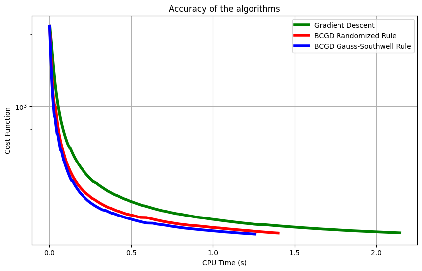

# Multi-class Logistic Regression with Gradient-Based Methods

Group homework for the *Optimization for Data Science* course (MSc Data Science, University of
Padova, 2023/2024). We derive the multi-class logistic regression problem, write its loss and
gradient in vectorized form, and compare three first-order methods implemented from scratch in
NumPy:

- **Gradient Descent (GD)**
- **Block Coordinate Gradient Descent with randomized rule (BCGD-R)**
- **Block Coordinate Gradient Descent with Gauss-Southwell rule (BCGD-GS)**

**Full report:** [report/report.pdf](report/report.pdf)

## Highlights

- Loss (negative log-likelihood) and gradient derived analytically, proved convex, and fully
  vectorized with matrix operations instead of loops.
- Fixed step size `1/L`, with `L` an upper bound of the Lipschitz constant of the gradient
  (`L <= ||A||_2 ||A||_F`).
- Each block is one column of the parameter matrix, i.e. one class: BCGD updates a single class per
  iteration, so each step is much cheaper than a full gradient step.
- On the real dataset GD reaches **93.1%** test accuracy, the two BCGD variants 92.6% and 92.2% while
  using 35-45% less CPU time.

## Data

- **Synthetic dataset**: `A` is a 1000 x 1000 matrix with standard normal entries, and the labels
  (k = 50 classes) are the argmax of each row of `AX + E`, with `X` and `E` also standard normal.
- **Real dataset**: [Optical Recognition of Handwritten Digits](https://archive.ics.uci.edu/dataset/80)
  from the UCI repository (5620 samples, 64 features, 10 classes), standardized and split into
  train and test sets. The notebook downloads it with `ucimlrepo`.

## Results

All methods run for at most 2000 iterations, with tolerance `1e-6` on the gradient norm.

| Method | CPU time, synthetic (s) | CPU time, digits (s) | Test accuracy, digits |
| --- | --- | --- | --- |
| Gradient Descent | 8.57 | 2.14 | 93.1% |
| Randomized BCGD | 4.63 | 1.40 | 92.6% |
| Gauss-Southwell BCGD | 4.56 | 1.25 | 92.2% |



The three methods have similar convergence per iteration, with GD showing the smoothest decrease
of the gradient norm. Per unit of CPU time the BCGD methods decrease the loss faster, because each
iteration updates only one block. GD keeps a slight edge in final accuracy. On problems of this
size the differences are small, but they would grow with the number of classes and features.

## Repository Structure

```text
├── logistic_regression_gradient_methods.ipynb   # full implementation and experiments
├── report/report.pdf                            # report with derivations and discussion
├── figures/                                     # figures used in the report
└── requirements.txt
```

## Getting Started

```bash
pip install -r requirements.txt
jupyter notebook logistic_regression_gradient_methods.ipynb
```

The notebook runs top to bottom, also on Google Colab. The random seed is fixed in the first code
cell; CPU times depend on the machine.

## Authors

Matteo Gorni Silvestrini, Tomas Guarini, Daniele Virzì, Martino Zaratin.
